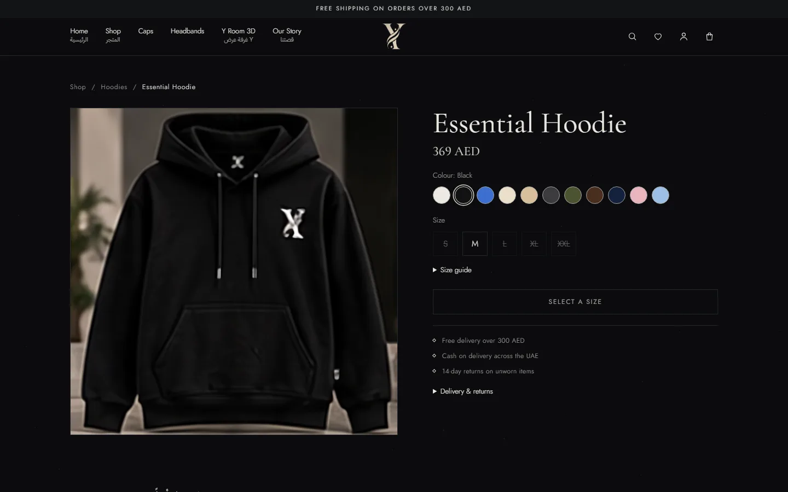
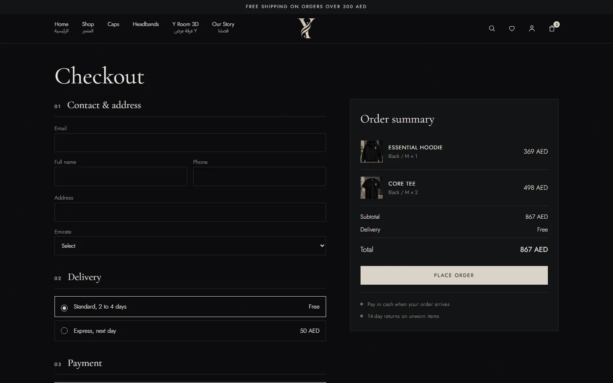
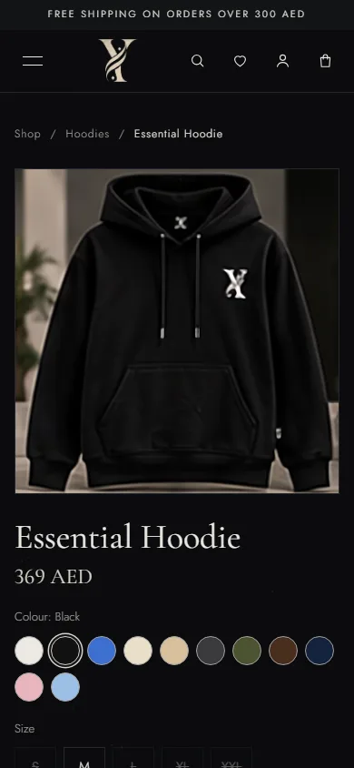

# Y Store

A full-stack streetwear store built with **Next.js 15** and **Supabase**: a bilingual English/Arabic storefront, server-rendered product pages, a transactional checkout, guest order tracking, customer accounts and an admin dashboard, plus an interactive 3D showroom.

**Live demo: [y-store-omega.vercel.app](https://y-store-omega.vercel.app)**


## Highlights

- **Database-enforced orders.** Checkout runs as a PostgreSQL function that locks products, recalculates prices and delivery on the server, and deducts per-variant stock in one transaction, so two shoppers can't buy the last item twice and a tampered cart can't change a price.
- **Safe retries.** Each checkout carries a request UUID: retrying the same request returns the same order instead of creating a duplicate.
- **Row-level security on every table.** Admin actions are checked on the server against `profiles.role`, never a browser flag. Guest order tracking returns status and items only, never phone numbers or addresses.
- **Abuse limits** on orders, contact messages, newsletter sign-ups and order lookups, enforced in the database so they also cover direct API calls.
- **SEO-ready product pages** with per-product metadata, schema.org `Product` data, a generated sitemap and stable URLs that redirect when a product is renamed.
- **Tested.** Node.js unit tests and SQL integration tests (run in a rolled-back transaction), with GitHub Actions running tests and a production build on every push.

## Screenshots

| Shop | Product page |
| --- | --- |
|  |  |
| **Checkout** | **Admin dashboard** |
|  |  |

| Mobile home | Mobile product page | 3D showroom |
| --- | --- | --- |
|  |  |  |

## Features

- **Storefront:** categories, search, price filter and sorting, colour and size selection with per-variant stock, size guide, wishlist and a cart drawer.
- **Product pages:** one URL per product (`/product/essential-hoodie-0`), related products, and a quick-view window from the product grid.
- **Checkout:** contact and delivery details, standard or express delivery with a free-delivery threshold, and cash on delivery.
- **Order tracking:** guests look up an order at `/track` with the order number and checkout email.
- **Accounts:** sign-up with email verification, password sign-in and recovery, order history, and cancelling an order while it is still New, which restores its stock once.
- **Admin dashboard:** products and variant stock, categories, image uploads, orders and status changes, printable invoices, delivery rates, contact messages and newsletter subscribers.
- **3D Locker Room:** a bundled Three.js showroom that shares the catalogue and cart with the store.
- **Arabic touches:** Arabic product names and headings throughout the interface. It is not a fully translated Arabic storefront.

## Tech stack

| Area | Tools |
| --- | --- |
| Frontend | Next.js 15 App Router, React 18, plain CSS |
| Backend | Next.js route handlers and middleware, Supabase Auth, PostgreSQL functions and RLS, Supabase Storage |
| 3D | Three.js |
| Quality | Node.js test runner, SQL integration tests, GitHub Actions |

## Run locally

Requires **Node.js 22 or newer**.

### Demo mode (no database)

```sh
npm ci
npm run dev
```

Open [localhost:3000](http://localhost:3000). With no environment variables set, the store runs on built-in demo data stored in the browser, including a local preview of `/admin`. Nothing is saved to a server.

### With Supabase

Copy `.env.example` to `.env.local` and fill in `NEXT_PUBLIC_SUPABASE_URL` and `NEXT_PUBLIC_SUPABASE_ANON_KEY`. Then follow [docs/SETUP.md](docs/SETUP.md) to run the SQL setup files in order and grant an admin account. Email configuration is covered in [docs/AUTH-EMAIL-SETUP.md](docs/AUTH-EMAIL-SETUP.md).

Never put a service-role key or any other server secret in a `NEXT_PUBLIC_*` variable.

## Tests

```sh
npm test        # inventory, validation and order-settings unit tests
npm run build   # production build
```

SQL tests in [`supabase/tests/`](supabase/tests) cover order retries, unavailable variants, duplicate lines, cancellation, unauthorized status changes and tracking privacy. They run against a configured database inside a transaction that is rolled back.

## Project structure

```text
app/                  Pages, layouts, product routes, auth callback and API routes
components/           Storefront, product, checkout, account and admin UI
lib/                  Catalogue, API helpers, shipping, rate limiter and Supabase clients
public/               Brand and product images, bundled 3D room
supabase/             SQL schema, access controls, migrations, email templates and SQL tests
tests/                Node.js unit tests
docs/                 Setup guides and screenshots
```

## Known limitations

- **Cash on delivery only;** there is no card payment integration yet.
- **Email delivery needs custom SMTP** for public sign-ups; Supabase's built-in sender only reaches project team members.
- The in-memory IP limiter is per server instance; the database limits back it up but are not full bot protection. There is no CAPTCHA or MFA.
- Product photos, prices and policy text are placeholders for a demo store.
