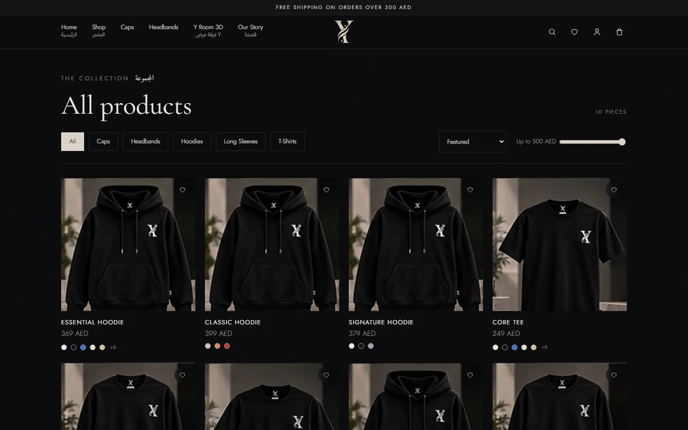
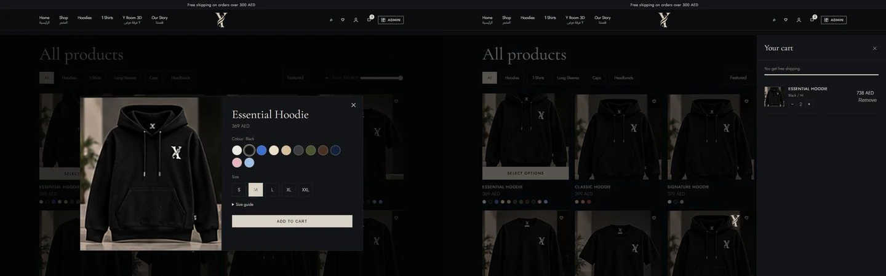
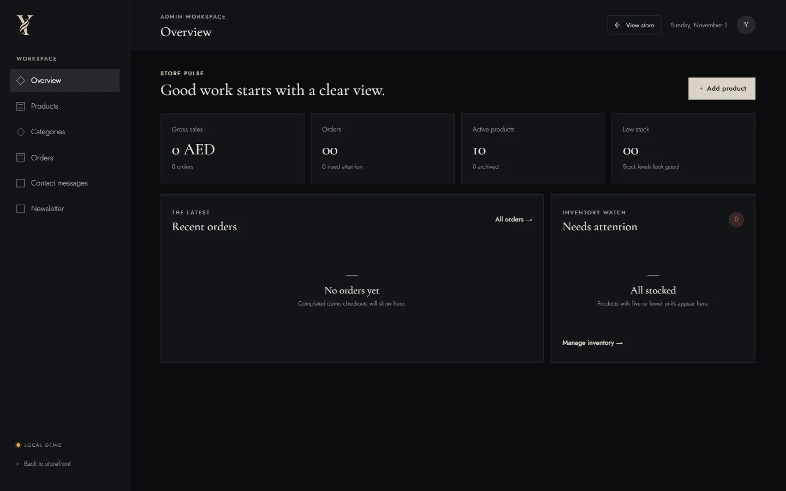
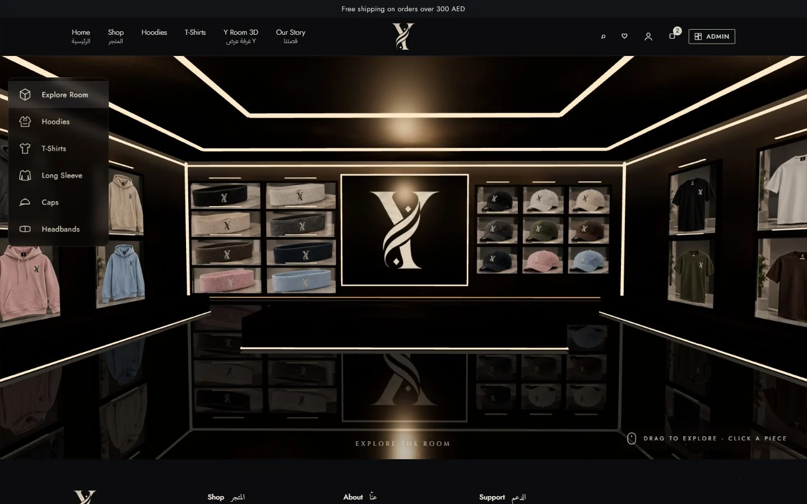

# Y Store

Y Store is a streetwear storefront built with Next.js and Supabase, pairing a conventional product catalog with an interactive 3D Locker Room showroom. Visitors can browse clothing and accessories, choose colours and sizes, save favourites, and place cash-on-delivery orders. A built-in browser-local demo lets you explore the interface without a database; Supabase enables persistent accounts, catalog administration and order processing.


## Features

- **Storefront:** category navigation, product search, price filtering, sorting, colour/size selection and a size guide.
- **Cart and wishlist:** saved browser-local selections, quantity controls and a cart drawer shared with the showroom.
- **Checkout:** delivery details, standard/express shipping, order confirmation and **cash on delivery**.
- **Order tracking:** guests check an order's status at `/track` with the order number and checkout email.
- **Accounts:** password sign-in, signup/email verification, password recovery and an email-code sign-in interface. Customers can edit their name, see order details and cancel an order while it is still New. Email delivery and numeric-code templates require Supabase email configuration.
- **Admin panel:** products, colour/size inventory, categories, orders/status changes, order details/invoices, delivery rates, contact messages (read/replied) and newsletter subscribers. Connected administrators can upload product images. Demo administration is a local preview, not production authentication.
- **3D Locker Room:** a bundled Three.js showroom whose garment selection and cart controls communicate with the store.
- **Arabic product localization:** optional Arabic product names in the editor and product displays, plus Arabic text in parts of the interface. This is not a fully translated Arabic storefront.

## Screenshots

All captures use built-in demo data on an isolated local origin, without Supabase credentials or real customer records. Desktop uses a 1440 × 900 viewport; mobile uses 390 × 844. The product/cart image combines two actual captures to cover both views within six gallery files. Each image is under 300 KB.

| Browse | Select and review |
| --- | --- |
|  |  |
|  |  |


## Tech stack

- **Next.js 15** App Router, server API routes and JavaScript/JSX.
- **React 18** with shared context for cart, wishlist, catalog and session UI.
- **Supabase** Auth, PostgreSQL and Storage, using `@supabase/supabase-js` and `@supabase/ssr`.
- Plain CSS, a bundled **Three.js** showroom, Node.js tests and GitHub Actions.

## Security and data integrity

These protections apply to the connected Supabase setup after its SQL scripts are installed. Local demo mode is an interface preview.

- **Row-level security:** database tables have RLS and access policies. Internal request/submission-limit tables use a non-public schema with no client access policies. See the [setup order](docs/SETUP.md#fresh-database-only).
- **Server-side admin checks:** protected admin APIs validate the authenticated user and check `profiles.role` on the server, rather than trusting a browser flag.
- **Authoritative orders:** database functions validate products, colours, sizes and combined quantities; recalculate prices/shipping; lock products; and update variant stock transactionally.
- **Retry/cancellation handling:** a request UUID prevents identical checkout retries from creating another order. Reusing it for different content is rejected. Cancellation restores stock once.
- **Rate limiting:** API handlers use an in-memory IP limiter. The supplied SQL adds shared database submission limits for orders, contact messages and newsletter inserts. These layers do not amount to comprehensive bot protection.
- **Request/browser protections:** write APIs reject mismatching Origin headers when present. Production responses enforce a Content Security Policy and other security headers; the policy still permits inline scripts/styles needed by the current application.
- **Order integrity tests:** [SQL tests](supabase/tests/order_integrity.sql) cover retries, unavailable variants, duplicate lines, missing sizes, cancellation and unauthorized status changes within a rollback transaction. They require a configured database and are separate from `npm test`.

## Run locally

Requires **Node.js 22 or newer** and npm.

### Demo mode — no Supabase required

Use a clean checkout with no local environment files and no Supabase/custom-API variables configured. No `.env` file is needed.

```sh
npm ci
npm run dev
```

Open [localhost:3000](http://localhost:3000). Try `/shop`, product options, the cart, `/admin` and `/locker-room`. Demo changes live in that browser's local storage; they do not create server accounts, send real emails or persist orders to Supabase. Use demo data only.

### With Supabase

Follow [SETUP.md](docs/SETUP.md) for database setup, public client configuration, administrator access and callback URLs. The code expects `NEXT_PUBLIC_SUPABASE_URL` and `NEXT_PUBLIC_SUPABASE_ANON_KEY` (a publishable key is supported). Leave `NEXT_PUBLIC_API_URL` empty for the built-in routes. See [email setup and its limitations](docs/AUTH-EMAIL-SETUP.md).

Keep actual configuration outside Git. Never put a service-role key, SMTP password or other server secret in a `NEXT_PUBLIC_*` variable. `.env.example` contains placeholders only.

## Tests and CI

```sh
npm test
npm run build
```

`npm test` runs Node.js inventory/validation tests in `tests/`. `npm run build` creates the production Next.js build; serve it with `npm start`.

The [GitHub Actions workflow](.github/workflows/check.yml) installs dependencies with `npm ci`, runs `npm test`, and runs `npm run build` on pushes and pull requests using Node.js 22. It does not run database SQL tests or verify email delivery.

## Project structure

```text
app/                  Pages, layouts, auth callback and server API routes
components/           Storefront, checkout, admin and showroom UI
lib/                  API helpers, catalog, shipping, limiter and Supabase clients
public/               Brand/product images and bundled 3D room
supabase/             SQL setup, access controls, email templates and SQL tests
tests/                Node.js inventory and validation tests
docs/                 Setup notes and optimized demo screenshots
.github/workflows/    Automated test/build checks
```

## Known limitations

- **Cash on delivery only:** no online card-payment integration.
- **Per-instance IP limits:** the in-memory limiter does not share counters across servers or survive restarts. Database submission limits supplement it but do not replace deployment-level abuse controls.
- **Email needs configuration:** public delivery requires custom SMTP. Numeric OTP messages require token-bearing templates; a visible email-code form alone does not prove delivery is configured.
- **Demo mode is not a backend:** browser-local accounts, permissions and orders are not suitable for a live store.
- MFA enrollment/challenge UI and CAPTCHA are not implemented. Product visuals, prices, inventory and policy text require review before selling.
- The 3D room retains its bundled garment visuals; changing a catalog image does not rebuild the room's textures.

## What to keep out of Git

The existing `.gitignore` excludes `.env`, `.env.local` and other environment variants, `node_modules/`, `.next/`, `.next-dev/`, logs, coverage and `*.zip`. Only the placeholder `.env.example` is exempted. Keep customer-data captures, database exports, SMTP/provider credentials and generated delivery archives outside the repository. Ignore rules do not remove already committed files; review staged filenames before pushing.
